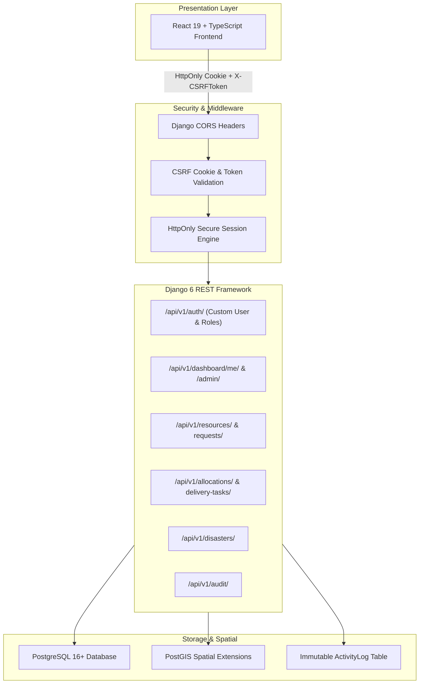
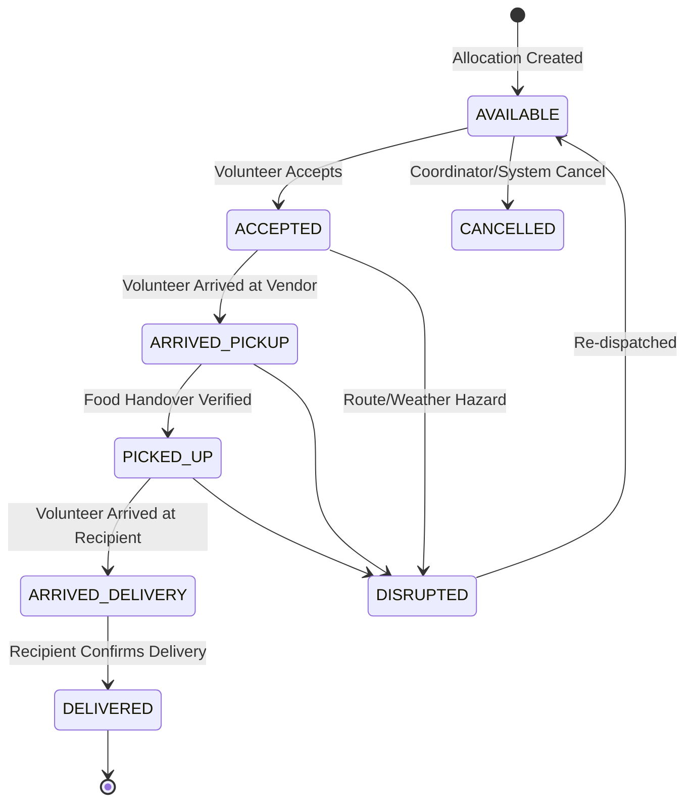

# NeighborNet AI — Backend Architecture Specification (Phase 2)

## 1. Architectural Principles

NeighborNet AI Phase 2 backend provides a secure, modular monolithic architecture designed for resilience, strict role isolation, dual-mode operational workflows, and high-concurrency disaster resource coordination.



---

## 2. Authentication & Authorization Model

### 2.1 Identity vs Platform Roles
- **Identity (`User`)**: Represents an individual with verified email, hashed password (Argon2 / PBKDF2), and primary profile.
- **Approved Roles (`UserRoleAssignment`)**: Separate approval records for `FOOD_PROVIDER`, `RECIPIENT`, `VOLUNTEER`, and `COORDINATOR`.
- **Multi-Role Capability**: A user can hold multiple roles simultaneously without needing separate accounts or identity switching (e.g., Ravi has both `FOOD_PROVIDER` and `VOLUNTEER`).
- **Coordinator Guard**: During public registration, self-selection of the `COORDINATOR` role is rejected at the serializer level.

### 2.2 Session Security
- Authentication relies on standard Django session cookies with `HttpOnly=True` and `SameSite=Lax`.
- Tokens are **never** returned to the browser for `localStorage` storage.
- CSRF protection is enforced on all state-mutating requests (`POST`, `PUT`, `PATCH`, `DELETE`).
- Handshake endpoint `GET /api/v1/auth/csrf/` sets the cookie and returns the token in JSON.

---

## 3. Inventory & Concurrency Management

### 3.1 Over-allocation Prevention
Resource reservations use PostgreSQL row-level locks via `select_for_update()` inside database transactions:

```python
with transaction.atomic():
    resource = Resource.objects.select_for_update().get(id=resource_id)
    if allocated_quantity > resource.available_quantity:
        raise ValidationError("Allocated quantity exceeds available inventory.")
    resource.allocated_quantity += allocated_quantity
    resource.save()
```

### 3.2 Automated Perishable Expiry
Perishable resources with `safe_until < timezone.now()` are automatically transitioned to `EXPIRED` status during catalog queries, preventing stale food allocation.

---

## 4. Delivery State Machine

Deliveries follow an explicit, irreversible state progression:



Direct updates bypassing intermediate steps (such as `DELIVERED` before `PICKED_UP`) are strictly prohibited by custom state-transition methods.

---

## 5. Dual Operational Modes

1. **Normal Community Mode**:
   - Focuses on surplus food recovery from commercial kitchens and supermarkets.
   - Resource categories include `cooked_meals`, `bakery`, `produce`, `pantry`.
   - Independent NGOs and charities claim and dispatch volunteers.

2. **Disaster Response Mode**:
   - Authorized Coordinators declare a `DisasterEvent`.
   - Resource categories expand to include `drinking_water` and `emergency_supplies`.
   - Emergency resource requests **must** link to an active `DisasterEvent`.
   - Priority-based sorting places urgent disaster requisitions at the top of courier feeds.

---

## 6. Audit & Accountability

All critical business mutations (listing surplus, claiming deliveries, status transitions, coordinator verifications, disaster activations) generate an immutable `ActivityLog` entry. Only approved Coordinators can query audit logs.
