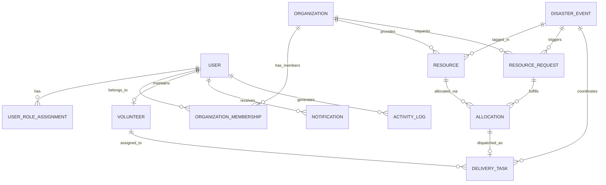

# NeighborNet AI — Database Schema & Data Dictionary (Phase 2)

NeighborNet AI uses PostgreSQL 16+ with PostGIS geographic capabilities. All primary keys are UUIDs (`uuid_generate_v4()`) to ensure global uniqueness and prevent sequential ID enumeration.

---

## 1. Entity-Relationship Diagram (ERD)

---

## 2. Table Specifications

### 2.1 `accounts_user`
Custom identity model replacing Django's default `auth.User`.

| Column | Type | Constraints | Description |
|---|---|---|---|
| `id` | `UUID` | PK, default `uuid4` | Unique User Identifier |
| `email` | `VARCHAR(254)` | UNIQUE, NOT NULL | Primary login identifier |
| `password` | `VARCHAR(128)` | NOT NULL | PBKDF2/Argon2 password hash |
| `name` | `VARCHAR(255)` | NOT NULL | User's full display name |
| `phone` | `VARCHAR(32)` | BLANK | Contact telephone number |
| `is_active` | `BOOLEAN` | DEFAULT TRUE | Active account flag |
| `is_staff` | `BOOLEAN` | DEFAULT FALSE | Django administrative access flag |
| `is_superuser`| `BOOLEAN` | DEFAULT FALSE | Superuser root privileges |
| `created_at` | `TIMESTAMP` | AUTO_NOW_ADD | Account creation time |

---

### 2.2 `accounts_userroleassignment`
Decoupled role approval matrix.

| Column | Type | Constraints | Description |
|---|---|---|---|
| `id` | `UUID` | PK | Assignment ID |
| `user_id` | `UUID` | FK (`accounts_user`), ON DELETE CASCADE | Target user |
| `role` | `VARCHAR(32)` | NOT NULL, ENUM | `FOOD_PROVIDER`, `RECIPIENT`, `VOLUNTEER`, `COORDINATOR` |
| `is_approved` | `BOOLEAN` | DEFAULT TRUE | Coordinator approval status |
| `granted_at` | `TIMESTAMP` | AUTO_NOW_ADD | Timestamp role was conferred |

---

### 2.3 `organizations_organization`
Commercial establishments, community kitchens, and NGOs.

| Column | Type | Constraints | Description |
|---|---|---|---|
| `id` | `UUID` | PK | Organization ID |
| `name` | `VARCHAR(255)` | NOT NULL | Business / NGO Name |
| `type` | `VARCHAR(32)` | NOT NULL, ENUM | `restaurant`, `bakery`, `supermarket`, `ngo`, `shelter`, `community_kitchen` |
| `contact_email`| `VARCHAR(254)`| NOT NULL | Official contact email |
| `contact_phone`| `VARCHAR(32)` | NOT NULL | Official contact phone |
| `address` | `TEXT` | NOT NULL | Physical street address |
| `latitude` | `FLOAT` | NOT NULL | WGS84 Latitude |
| `longitude`| `FLOAT` | NOT NULL | WGS84 Longitude |
| `is_verified` | `BOOLEAN` | DEFAULT FALSE | Coordinator verification flag |
| `operating_hours`| `VARCHAR(100)`| BLANK | Operating schedule |

---

### 2.4 `resources_resource`
Surplus food lots and disaster relief supplies.

| Column | Type | Constraints | Description |
|---|---|---|---|
| `id` | `UUID` | PK | Resource lot ID |
| `provider_id` | `UUID` | FK (`organizations_organization`), ON DELETE CASCADE | Provider entity |
| `name` | `VARCHAR(255)` | NOT NULL | Item name |
| `category` | `VARCHAR(32)` | NOT NULL, ENUM | `cooked_meals`, `bakery`, `produce`, `pantry`, `drinking_water`, `emergency_supplies` |
| `quantity` | `FLOAT` | CHECK (`quantity > 0`) | Total listed quantity |
| `allocated_quantity`| `FLOAT`| DEFAULT 0.0, CHECK (`<= quantity`) | Reserved quantity |
| `unit` | `VARCHAR(16)` | NOT NULL, ENUM | `kg`, `meals`, `liters`, `boxes`, `units` |
| `status` | `VARCHAR(32)` | NOT NULL, ENUM | `AVAILABLE`, `RESERVED`, `COLLECTED`, `DEPLETED`, `EXPIRED`, `WITHDRAWN` |
| `pickup_start` | `TIMESTAMP` | NOT NULL | Beginning of pickup window |
| `pickup_end` | `TIMESTAMP` | NOT NULL | End of pickup window |
| `safe_until` | `TIMESTAMP` | NULL | Perishable consumption limit |
| `storage_requirements`| `VARCHAR(128)`| NOT NULL | e.g. Ambient, Refrigerated, Hot hold |
| `dietary_tags`| `JSONB` | DEFAULT `[]` | e.g. Halal, Vegetarian, Vegan |
| `is_disaster_relief`| `BOOLEAN` | DEFAULT FALSE | Requisitioned for disaster |
| `disaster_event_id`| `UUID` | FK (`disasters_disasterevent`), NULL | Related disaster |

---

### 2.5 `requests_resourcerequest`
Requisitions submitted by recipient NGOs and shelters.

| Column | Type | Constraints | Description |
|---|---|---|---|
| `id` | `UUID` | PK | Requisition ID |
| `recipient_id`| `UUID` | FK (`organizations_organization`), ON DELETE CASCADE | Recipient NGO |
| `item_name` | `VARCHAR(255)` | NOT NULL | Needed resource description |
| `category` | `VARCHAR(32)` | NOT NULL, ENUM | Resource category |
| `requested_quantity`| `FLOAT`| CHECK (`> 0`) | Total needed amount |
| `fulfilled_quantity`| `FLOAT`| DEFAULT 0.0, CHECK (`<= requested_quantity`) | Delivered quantity |
| `unit` | `VARCHAR(16)` | NOT NULL, ENUM | Measurement unit |
| `priority` | `VARCHAR(16)` | NOT NULL, ENUM | `low`, `normal`, `high`, `urgent` |
| `status` | `VARCHAR(32)` | NOT NULL, ENUM | `OPEN`, `PARTIALLY_ALLOCATED`, `ALLOCATED`, `FULFILLED`, `CANCELLED` |
| `urgency_deadline`| `TIMESTAMP` | NOT NULL | Delivery cutoff deadline |
| `delivery_address`| `TEXT` | NOT NULL | Physical destination |
| `people_impacted`| `INTEGER` | DEFAULT 0 | Estimated beneficiaries |
| `is_disaster_relief`| `BOOLEAN` | DEFAULT FALSE | Emergency requisition flag |
| `disaster_event_id`| `UUID` | FK (`disasters_disasterevent`), NULL | Linked disaster |

---

### 2.6 `volunteers_volunteer`
Courier profile linked to a user account.

| Column | Type | Constraints | Description |
|---|---|---|---|
| `id` | `UUID` | PK | Volunteer ID |
| `user_id` | `UUID` | ONE-TO-ONE (`accounts_user`), CASCADE | Associated user |
| `status` | `VARCHAR(16)` | ENUM | `available`, `busy`, `offline` |
| `vehicle_type`| `VARCHAR(32)` | ENUM | `bicycle`, `motorbike`, `car`, `van`, `foot` |
| `vehicle_capacity_kg`| `FLOAT` | DEFAULT 15.0 | Max payload weight |
| `completed_deliveries_count`| `INTEGER`| DEFAULT 0 | Completed delivery tally |
| `rating` | `FLOAT` | DEFAULT 5.0 | Courier rating (0.0 - 5.0) |
| `verified` | `BOOLEAN` | DEFAULT FALSE | Background verification status |
| `service_area`| `VARCHAR(100)`| NOT NULL | Geographical district / city |
| `latitude` | `FLOAT` | NULL | Consented GPS Latitude |
| `longitude`| `FLOAT` | NULL | Consented GPS Longitude |

---

### 2.7 `deliveries_allocation`
Binding record between a Resource lot and a Requisition.

| Column | Type | Constraints | Description |
|---|---|---|---|
| `id` | `UUID` | PK | Allocation ID |
| `resource_id` | `UUID` | FK (`resources_resource`), ON DELETE CASCADE | Allocated resource |
| `request_id` | `UUID` | FK (`requests_resourcerequest`), ON DELETE CASCADE | Associated request |
| `allocated_quantity`| `FLOAT`| CHECK (`> 0`) | Reserved quantity |
| `status` | `VARCHAR(32)` | ENUM | `PENDING`, `APPROVED`, `FULFILLED`, `CANCELLED` |
| `created_by_id`| `UUID` | FK (`accounts_user`), NULL | Coordinator who created allocation |

---

### 2.8 `deliveries_deliverytask`
Physical pickup & delivery dispatch lifecycle.

| Column | Type | Constraints | Description |
|---|---|---|---|
| `id` | `UUID` | PK | Delivery task ID |
| `allocation_id`| `UUID` | FK (`deliveries_allocation`), NULL | Sourced allocation |
| `volunteer_id` | `UUID` | FK (`volunteers_volunteer`), NULL | Assigned courier |
| `pickup_address`| `TEXT` | NOT NULL | Origin address |
| `delivery_address`| `TEXT`| NOT NULL | Destination address |
| `delivery_deadline`| `TIMESTAMP`| NOT NULL | Completion cutoff |
| `priority` | `VARCHAR(16)` | ENUM | Priority tier |
| `status` | `VARCHAR(32)` | ENUM | `AVAILABLE`, `ACCEPTED`, `ARRIVED_PICKUP`, `PICKED_UP`, `ARRIVED_DELIVERY`, `DELIVERED`, `DISRUPTED`, `CANCELLED` |
| `disruption_reason`| `TEXT` | BLANK | Reason if transit disrupted |

---

### 2.9 `disasters_disasterevent`
Emergency declaration records.

| Column | Type | Constraints | Description |
|---|---|---|---|
| `id` | `UUID` | PK | Disaster Event ID |
| `name` | `VARCHAR(255)` | NOT NULL | Disaster title |
| `disaster_type`| `VARCHAR(32)` | ENUM | `flood`, `cyclone`, `landslide`, `tsunami`, `drought`, `other` |
| `severity` | `VARCHAR(16)` | ENUM | `advisory`, `watch`, `warning`, `critical` |
| `status` | `VARCHAR(16)` | ENUM | `DRAFT`, `ACTIVE`, `RESOLVED`, `CLOSED` |
| `affected_regions`| `JSONB` | DEFAULT `[]` | Affected districts / divisions |
| `declared_by_id`| `UUID` | FK (`accounts_user`), NULL | Coordinator author |
| `started_at` | `TIMESTAMP` | NOT NULL | Activation timestamp |
| `resolved_at`| `TIMESTAMP` | NULL | Resolution timestamp |
